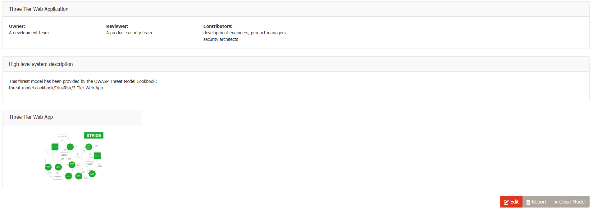
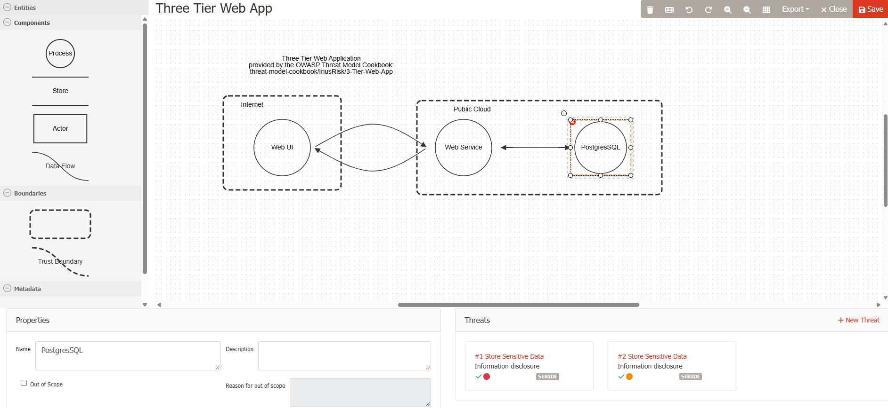

# Threat modeling skills for coding agents (Threat Dragon)

A set of three skills that follow the open **Agent Skills** standard (`SKILL.md` + YAML frontmatter). They work with
Claude Code, OpenCode, Cline, Codex, Cursor, GitHub Copilot, and other agents that support skills.

| Skill | What it does | Output |
|---|---|---|
| `threat-model-draft` | Reads the design and code, then drafts a STRIDE threat model (DFD, trust boundaries, threats) | `threat-model/<slug>.json` (open in Threat Dragon), `<slug>.review.md`, `<slug>.draft-log.json` |
| `threat-to-requirements` | Turns a reviewed threat model into security requirements with IDs, rules for coding agents, and a backlog | `SECURITY-REQUIREMENTS.md`, a block in `AGENTS.md`/`CLAUDE.md`, `backlog.csv` (optional) |
| `threat-check` | Compares a diff (MR/PR/branch) against the threat model and requirements: coverage, regression, drift | Markdown report (for local use or CI) |

## Table of contents

1. [Workflow](#workflow)
2. [Example in Threat Dragon](#example-in-threat-dragon)
3. [Why it works with many agents](#why-it-works-with-many-agents)
4. [Quick start](#quick-start)
5. [Installer reference](#installer-reference)
6. [Configuration (optional)](#configuration-optional)
7. [How to invoke](#how-to-invoke)
8. [Using threat-check in CI](#using-threat-check-in-ci)
9. [tdtool.py: manual use](#tdtoolpy-manual-use)
10. [About OWASP Threat Dragon](#about-owasp-threat-dragon)
11. [Notes on Threat Dragon](#notes-on-threat-dragon)
12. [License](#license)

## Workflow

```
Design ─► [threat-model-draft] ─► Review in Threat Dragon (a human decides)
                                            │
                                            ▼
                               [threat-to-requirements] ─► SECURITY-REQUIREMENTS.md + AGENTS.md
                                            │
                                            ▼
                     Coding agent writes code per SRs ─► [threat-check] on the MR ─► update threat status
```

The AI only drafts and checks. Every risk decision (Open / NotApplicable / Accepted / Mitigated) is made by a
human in Threat Dragon. The skills never close a threat on their own.

## Example in Threat Dragon

After `threat-model-draft` writes `threat-model/<slug>.json`, open the file in Threat Dragon. The screenshots below
show a sample model (a three-tier web app) in the Threat Dragon web app.

**Model summary.** Threat Dragon shows the owner, reviewer, contributors, the high-level system description and
one card per diagram. Use **Edit** to open a diagram, or **Report** to export it.



**Diagram and threats.** The data flow diagram has elements (Web UI, Web Service, PostgreSQL), data flows and trust
boundaries (Internet, Public Cloud). Select an element to see its properties and its list of STRIDE threats at the
bottom. Each threat card shows its title, STRIDE type and status, and a colored dot for its severity.



For a model generated by these skills, see [`threat-skills/examples/order-portal.json`](threat-skills/examples/order-portal.json).
## Why it works with many agents

- It uses only the standard frontmatter (`name`, `description`) and agent-neutral instructions. It relies on no
  agent-specific feature.
- The hard parts (generating valid Threat Dragon JSON, diagram layout, threat numbering, extraction) live in
  `scripts/tdtool.py`. It needs **Python 3.8+ and the standard library only**, with nothing to install. Any model
  (Claude, Qwen, GPT, and so on) only has to write a simple JSON spec file, so results stay stable even with
  self-hosted models.
- Generated model files are validated against the official Threat Dragon v2 JSON schema.

## Quick start

1. **Get this repo** (once, anywhere on your machine):

   ```bash
   git clone https://github.com/vankhangfet/threat-model-skills.git
   cd threat-model-skills/threat-skills
   ```

2. **Run the installer against your project.** Pick the line for your OS and the agents your team uses
   (`claude`, `codex`, `copilot`, `cline`, `opencode`, `kiro`, `pi`, or omit `-a` for all):

   ```bash
   # macOS / Linux / Git Bash
   ./install.sh -a claude,kiro /path/to/project-repo
   ```

   ```powershell
   # Windows PowerShell
   ./install.ps1 -Agents claude,kiro C:\path\to\project-repo
   ```

3. **Check the result.** Your project now has the skills in each agent's folder and a
   `threat-model/config.json`:

   ```
   project-repo/
   ├── .claude/skills/threat-model-draft/SKILL.md    (one folder per selected agent)
   ├── .claude/skills/threat-to-requirements/SKILL.md
   ├── .claude/skills/threat-check/SKILL.md
   └── threat-model/config.json
   ```

   Requirement: Python 3.8+ must be available on the machine that runs the agent (used by `tdtool.py`).

4. **Set your options** in `threat-model/config.json` (see [Configuration](#configuration-optional)).
   The default language is `en`.

5. **Commit** the new folders so the whole team shares the same skills:

   ```bash
   git add .claude .kiro threat-model && git commit -m "Add threat modeling skills"
   ```

6. **Restart your agent session** in the project and try it:
   "Build a threat model for the refund feature based on docs/design/refund.md".
   Open the generated `threat-model/<slug>.json` in Threat Dragon to review it.

**Update later:** pull the latest version of this repo and run the same installer command again. It replaces
the skills in place and keeps your `threat-model/` files.

**Remove:** `./install.sh --uninstall -a claude,kiro /path/to/project-repo` (or `./install.ps1 -Uninstall -Agents claude,kiro ...`).
## Installer reference

The installer copies the three skills into the folder each agent reads from, and creates
`threat-model/config.json` if it does not exist (an existing one is never overwritten).

| Agent | `--agents` name | Project skills folder |
|---|---|---|
| Claude Code | `claude` | `.claude/skills/` |
| Codex | `codex` | `.agents/skills/` |
| GitHub Copilot | `copilot` | `.github/skills/` |
| Cline | `cline` | `.cline/skills/` |
| OpenCode | `opencode` | `.opencode/skills/` |
| Kiro | `kiro` | `.kiro/skills/` |
| Pi harness | `pi` | `.pi/skills/` |

macOS / Linux / Git Bash:

```bash
./install.sh /path/to/project-repo                          # all agents
./install.sh -a claude,kiro /path/to/project-repo          # only the agents you pick
./install.sh -a codex,copilot --copy /path/to/project-repo  # real copies instead of symlinks
./install.sh --dry-run /path/to/project-repo                # show what would happen
./install.sh --uninstall -a pi /path/to/project-repo        # remove (keeps threat-model/)
./install.sh --list                                         # supported agents and folders
```

Windows PowerShell (always copies, no symlinks, no admin rights needed):

```powershell
./install.ps1 C:\path\to\project-repo
./install.ps1 -Agents claude,kiro C:\path\to\project-repo
./install.ps1 -Agents pi -WhatIf C:\path\to\project-repo    # dry run
./install.ps1 -Uninstall -Agents pi C:\path\to\project-repo
```

By default `install.sh` writes one real copy into the first selected folder and symlinks the others to it, so
the skills stay in sync. Re-running the installer updates the skills in place.

Skill folder locations can change between agent versions. Check your agent's documentation if a skill is not
picked up, and copy the skills to the right folder (or add it to the `agent_dir` list in the scripts).

**Agents without skill support:** add this to `AGENTS.md` (or the agent's rules file):

```markdown
## Threat modeling skills
When asked to threat model, convert threats to requirements, or check a change against the threat model,
read and follow the matching file: .agents/skills/threat-model-draft/SKILL.md,
.agents/skills/threat-to-requirements/SKILL.md, .agents/skills/threat-check/SKILL.md.
```

Commit these directories so the whole team uses the same skill version.
## Configuration (optional)

`threat-model/config.json` (install.sh creates it from `config.example.json`):
`language` (`vi`/`en`, for descriptions, requirements, and reports), `baseBranch`, `requirementsFile`,
`agentRulesFiles`, `backlogCsv`.

## How to invoke

Plain natural language is enough (the agent picks the skill from its description). You can also call the skill by
name if the agent supports it:

- "Build a threat model for the refund feature based on docs/design/refund.md"
- "The threat model is reviewed, convert it into security requirements"
- "Run a threat check of the current branch against main"

## Using threat-check in CI

Run the agent in non-interactive mode on the MR and post the report as a comment. Example: GitLab CI with Claude Code
(other agents have an equivalent headless mode, such as `opencode run` or `codex exec`; see each tool's
documentation):

```yaml
threat_check:
  stage: test
  rules: [{ if: '$CI_PIPELINE_SOURCE == "merge_request_event"' }]
  script:
    - git fetch origin $CI_MERGE_REQUEST_TARGET_BRANCH_NAME
    - claude -p "Use the threat-check skill. Base branch: origin/$CI_MERGE_REQUEST_TARGET_BRANCH_NAME. Write the report to threat-check-report.md." 
  artifacts: { paths: [threat-check-report.md], when: always }
```

In CI the skill only writes the report. It does not edit files or change threat status.

## tdtool.py: manual use

```bash
T=.agents/skills/threat-model-draft/scripts/tdtool.py
python3 $T build   threat-model/drafts/x.spec.json threat-model/x.json   # spec -> Threat Dragon model
python3 $T extend  threat-model/x.json threat-model/drafts/x.delta.json  # add new parts, keep the reviewer's edits
python3 $T validate threat-model/x.json [--fix]
python3 $T extract threat-model/x.json --format md [--status Open]
python3 $T set-status threat-model/x.json --threat T-004 --status Mitigated --note "MR !123"
python3 $T stats   threat-model/x.json      # counts + share of AI-proposed threats kept after review
```

`stats` reads the `.draft-log.json` file to measure the quality of the AI draft (kept / rejected / added by
humans), which supports pilot evaluation.

## About OWASP Threat Dragon

[OWASP Threat Dragon](https://owasp.org/projects/threat-dragon) is a free, open-source (Apache 2.0),
cross-platform threat modeling tool with OWASP Production status. You draw data flow diagrams and list threats
and mitigations for each element. Source code: [github.com/OWASP/threat-dragon](https://github.com/OWASP/threat-dragon).
Documentation: [owasp.org/www-project-threat-dragon](https://owasp.org/www-project-threat-dragon/).

These skills draft the model; Threat Dragon is where the team reviews it. Ways to open the generated
`threat-model/<slug>.json`:

| Option | Storage | Use it when |
|---|---|---|
| Desktop app (Windows, macOS, Linux installers from the [GitHub releases](https://github.com/OWASP/threat-dragon/releases)) | Local files only | You want the quickest start: open the JSON file directly. |
| Web app, hosted demo or self-hosted | Local filesystem, or GitHub / GitLab / Bitbucket / GitHub Enterprise when configured | The team reviews models stored in the project repo. |
| Docker image `threatdragon/owasp-threat-dragon:stable` | Same as the web app | You self-host the web app. |

Quick self-hosted run (the web app needs environment variables and, for repository access, a registered
OAuth app; see the Threat Dragon docs):

```bash
docker run -it --rm -p 8080:3000 -v $(pwd)/.env:/app/.env threatdragon/owasp-threat-dragon:stable
# then open http://localhost:8080/
```

Review steps in Threat Dragon:

1. Open the generated model (desktop: *Open existing threat model*; web: select the repo and the file).
2. Check the diagram: elements, data flows and trust boundaries. Drag elements to tidy the layout.
3. Go through each threat. Edit it, delete it, or add missing ones.
4. Set the final status of each threat (Open, Mitigated, Accepted, and so on) and write the mitigation.
5. Save, commit the JSON file, then run `threat-to-requirements`.
## Notes on Threat Dragon

- The model is stored in `threat-model/` in the repo. Configure Threat Dragon (web version) to connect to
  GitLab/GitHub to open and save directly, or use the desktop version to open the local file.
- The generated model uses the v2 format. The `Critical` severity and the `Accepted/Transferred/Avoided/Eliminated`
  statuses require a recent Threat Dragon 2.x. Deploy the latest version (v2.6.2 at the time of writing).
- The first time you open an AI-generated model, the diagram is laid out in columns (one column per trust
  boundary). The reviewer only needs to drag elements into a more readable arrangement.

## License

[MIT](LICENSE). OWASP Threat Dragon is a separate project under the Apache 2.0 license.
